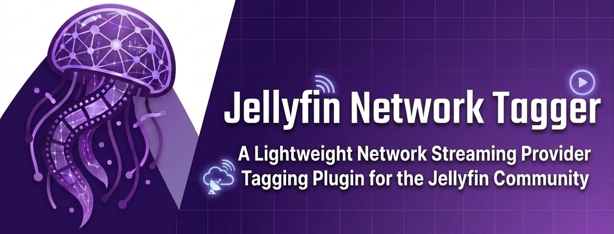
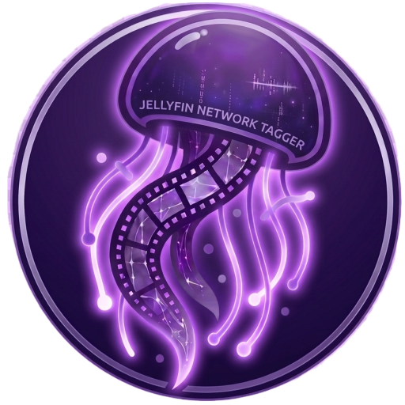
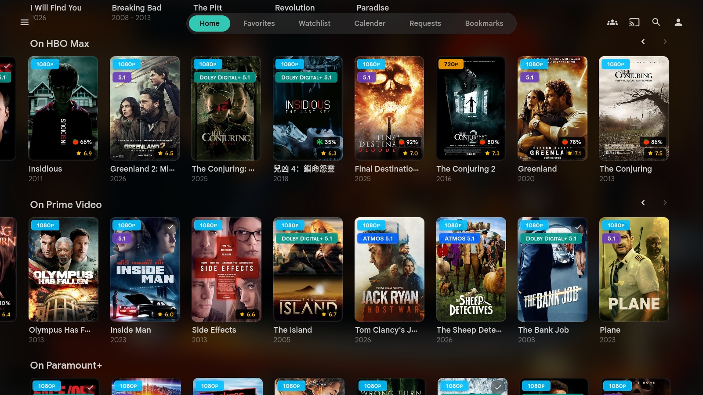
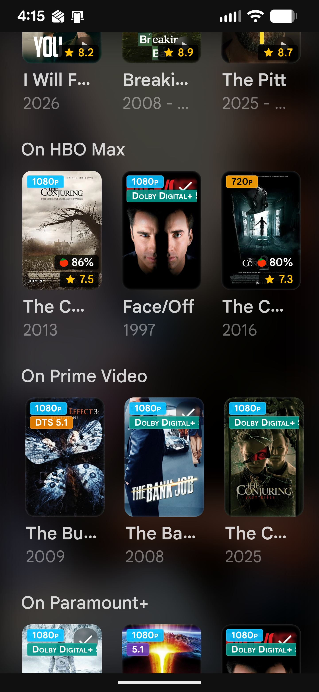
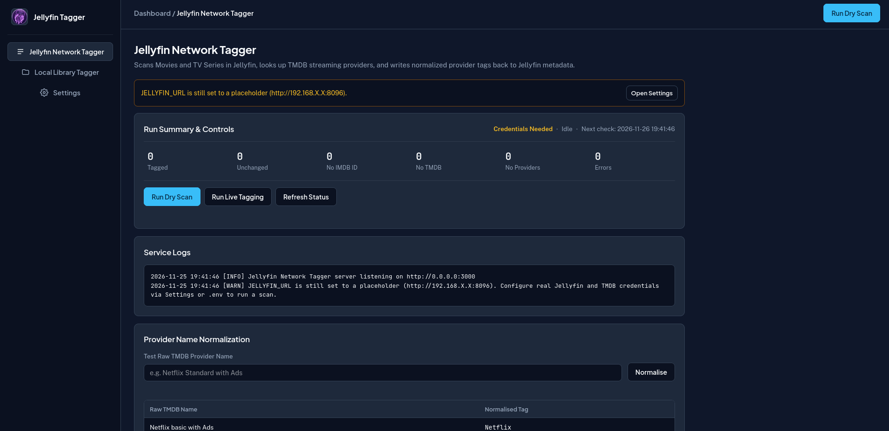
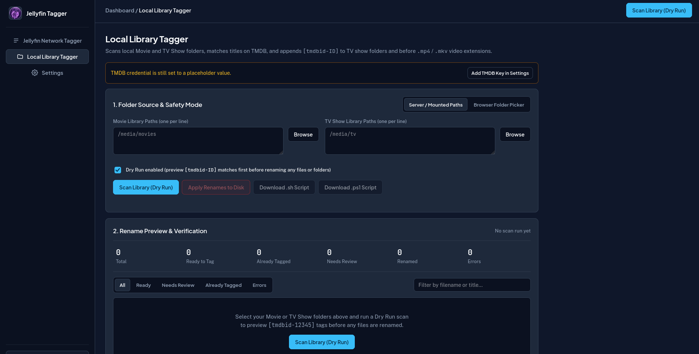
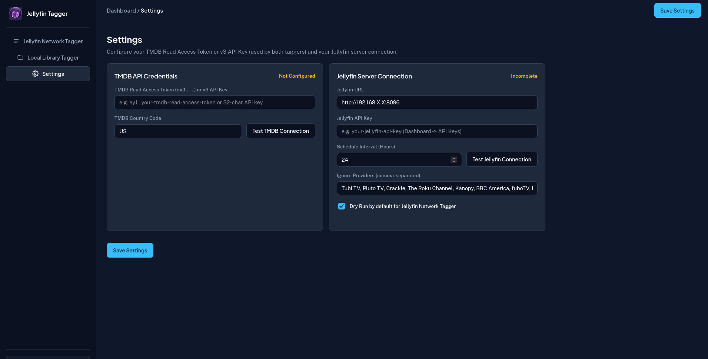

<p align="center">
  
</p>

<p align="center">
  
</p>

<h1 align="center">Jellyfin Network Tagger</h1>

<p align="center">
  
  
  
  
  
</p>

<p align="center">
  
  
  
  
  
  
  
</p>

<p align="center">
  <a href="https://hub.docker.com/r/jhosted/jellyfin-network-tagger">
    
  </a>
  <a href="https://github.com/jpwebdude/jellyfin-network-tagger/pkgs/container/jellyfin-network-tagger">
    
  </a>
  <a href="https://github.com/jpwebdude/jellyfin-network-tagger/issues">
    
  </a>
  <a href="https://buymeacoffee.com/jpwebdude">
    
  </a>
</p>

A self-hosted **Web Dashboard** and Docker service for [Jellyfin](https://jellyfin.org/) (supporting **v10.8 through v12.4+**) that runs entirely in your browser on port `3000`. It combines two integrated tools in one interface:

1. **Jellyfin Network Tagger** — Scans your Jellyfin Movies and TV Series, queries [TMDB](https://www.themoviedb.org/) streaming availability, and writes clean, normalized network tags (`Netflix`, `Max`, `Disney+`, `Prime Video`, `Apple TV+`, `Paramount+`, `Discovery+`, and more) directly into Jellyfin metadata.
2. **Local Library Tagger** — Scans local Movie and TV Show folders, matches titles on TMDB, and appends Jellyfin-standard `[tmdbid-12345]` tags to TV show folders and video files (right before `.mp4`, `.mkv`, etc.) with Dry Run safety previews.

These network tags work seamlessly with plugins like **Auto Collections** ([github.com](https://github.com/KeksBombe/jellyfin-plugin-auto-collections)) or **SmartLists** ([github.com](https://github.com/jyourstone/jellyfin-smartlists-plugin)) to build per-network collections automatically, and can be featured on your Jellyfin home screen with **KefinTweaks** ([github.com](https://github.com/ranaldsgift/KefinTweaks)).

---

## ✨ Features

- **100% Web Dashboard Interface** — Manage credentials, test connections, trigger dry runs or live scans, and inspect logs directly in your browser on port `3000`. No terminal commands or `.env` editing required after container startup.
- **Jellyfin Server v12.4+ Compatible** — Uses full `BaseItemDto` read-modify-write updates, non-null collection preservation, paginated library endpoints, and an in-dashboard **Test Jellyfin Connection** check against `/System/Info`.
- **Non-Destructive Metadata Updates** — Appends streaming provider tags without overwriting your existing custom Jellyfin tags, genres, studios, or lock settings.
- **Local Library Tagger (`[tmdbid-ID]`)** — Supports three workflows for tagging local storage:
  - **Server / Mounted Paths**: Scan and rename directly on Docker-mounted folders (`/media/movies`, `/media/tv`) with an interactive server directory browser.
  - **Browser Folder Picker**: Pick local folders straight from Chromium-based browsers without mounting extra Docker volumes.
  - **Downloadable Batch Scripts**: Export verified `.sh` (Linux/macOS) or `.ps1` (Windows PowerShell) rename scripts after reviewing matches.
- **Dry Run Safety First** — Both taggers default to **Dry Run** so you can verify matches, fix any uncertain TMDB matches manually in the UI, and confirm zero errors before writing to Jellyfin or renaming files on disk.
- **Flexible TMDB Authentication** — Accepts either a TMDB **Read Access Token** (`eyJ...`) or a **v3 API Key** in Settings, verified via a built-in **Test TMDB Connection** button.
- **Persistent Settings Volume** — Settings and saved local library paths persist across container restarts and image updates in `/app/data/config.json`.
- **Provider Name Normalization & Tester** — Automatically collapses verbose TMDB provider names (e.g., `Netflix Standard with Ads` → `Netflix`, `HBO Max Amazon Channel` → `Max`) and lets you test raw names right from the dashboard.
- **Scheduled Background Scans** — Configurable automatic scan interval (default: every `24` hours).
- **Multi-Architecture Docker Images** — Published to GHCR and Docker Hub for `linux/amd64`, `linux/arm64`, and `linux/arm/v7`.

---

## 📸 Network Row Screenshots

<p align="center">
  <a href="docs/images/jellyfin-desktop-network-rows.jpg">
    
  </a>
  <a href="docs/images/jellyfin-mobile-network-rows.jpg">
    
  </a>
</p>


## 🎥 Dashboard Preview - http://server-ip:3000


<p align="center">
 <a href="docs/images/dashboard1.png">
    
  </a>
  </a>
</p>
<p align="center">
 <a href="docs/images/dashboard2.png">
    
  </a>
  </a>
</p>
<p align="center">
 <a href="docs/images/dashboard3.png">
    
  </a>
  </a>
</p>
---

## 📋 Prerequisites

Before deploying, make sure you have:

| Requirement | Notes |
| --- | --- |
| **Docker** | Docker Engine or Docker Desktop with Compose v2 |
| **Jellyfin Server** | **v10.8 through v12.4+** (Docker or bare-metal) |
| **Jellyfin API Key** | In Jellyfin: **Dashboard → API Keys → `+`** (name it `Jellyfin Network Tagger`) |
| **TMDB Account** | Free account at [themoviedb.org](https://www.themoviedb.org/) |
| **TMDB Token or Key** | In TMDB: **Settings → API** — either your **API Read Access Token** (`eyJ...`) or **API Key (v3 auth)** |
| **IMDB / TMDB Metadata** | For **Jellyfin Network Tagger**, items in Jellyfin should have IMDB or TMDB ProviderIds populated |

---

## 🚀 Step-by-Step Setup Guide

### Step 1 — Create Your `docker-compose.yml`

Create a folder on your server (for example, `jellyfin-network-tagger`) and create a `docker-compose.yml` file inside it.

#### Option A — Pre-built Image from GHCR (Recommended)

```yaml
services:
  jellyfin-network-tagger:
    image: ghcr.io/jpwebdude/jellyfin-network-tagger:latest
    container_name: jellyfin-network-tagger
    restart: unless-stopped
    user: "1000:1000"
    ports:
      - "3000:3000"
    volumes:
      # Required: persists all dashboard Settings across container restarts & updates
      - ./config:/app/data

      # Optional: mount your local media folders if using Server Paths in Local Library Tagger
      # - /path/to/your/movies:/media/movies
      # - /path/to/your/tv:/media/tv
    networks:
      - media-stack_default

networks:
  media-stack_default:
    external: true
```

#### Option B — Pre-built Image from Docker Hub

Replace the `image:` line above with:

```yaml
    image: jhosted/jellyfin-network-tagger:latest
```

#### Option C — Build Locally from Source

```bash
git clone https://github.com/jpwebdude/jellyfin-network-tagger.git
cd jellyfin-network-tagger
cp docker-compose.example.yml docker-compose.yml
```

Edit `docker-compose.yml` to comment out `image:` and uncomment `build: .`.

> **Networking Tip (`network_mode: host`):**
> - If your Jellyfin container uses `network_mode: host`, Docker containers on a bridge network cannot join `host` mode. Remove or omit the `networks:` block in your `docker-compose.yml` if you don't use a custom bridge network, and enter your host machine's **LAN IP** (e.g., `http://192.168.1.100:8096`) in Settings instead of `localhost`.
> - If Jellyfin shares the same Docker bridge network (e.g., `media-stack_default`), verify the network name with `docker network ls` and you can use either your LAN IP or `http://jellyfin:8096`.

---

### Step 2 — Start the Container

Make sure your local `./config` directory is writable by UID/GID `1000` (or matches the `user:` in your Compose file), then bring up the container:

```bash
mkdir -p config
docker compose up -d
```

If building from source (Option C), run:

```bash
docker compose up -d --build
```

---

### Step 3 — Open the Web Dashboard

Open your browser and go to:

```text
http://<your-server-ip>:3000
```

You will see the dashboard with the left sidebar navigation:
- **Jellyfin Network Tagger** (`/`)
- **Local Library Tagger** (`/local-tagger`)
- **Settings** (`/settings`)
- **Buy Me a Coffee** (Optional, I love coffee and donation's support continued development of the project)

---

### Step 4 — Enter Your Settings on First Boot

Click **Settings** in the sidebar to configure your credentials. Everything you save here is stored in `/app/data/config.json` (your mounted `./config` folder) and automatically reloads on future container restarts.

#### 1. TMDB API Credentials
1. **TMDB Read Access Token (`eyJ...`) or v3 API Key**: Paste either your long TMDB Read Access Token or your shorter v3 API Key.
2. **TMDB Country Code**: Enter your two-letter region code (default: `US`, e.g., `CA`, `GB`, `AU`, `DE`).
3. Click **Test TMDB Connection** — confirm it reports a successful TMDB connection and shows whether Bearer Token or v3 API Key auth was detected.

#### 2. Jellyfin Server Connection
1. **Jellyfin URL**: Enter the full URL to your Jellyfin server (e.g., `http://192.168.1.100:8096` or `http://jellyfin:8096`). Avoid `localhost` inside Docker.
2. **Jellyfin API Key**: Paste the API key generated in Jellyfin under **Dashboard → API Keys**.
3. **Schedule Interval (Hours)**: Set how often automatic background scans run (default: `24`).
4. **Ignore Providers (comma-separated)**: Optional list of streaming providers you do not want added as tags (for example: `Tubi TV,Pluto TV,Crackle,The Roku Channel,Kanopy,fuboTV,Philo`).
5. **Dry Run by default for Jellyfin Network Tagger**: Recommended **checked** for your first scan so you can preview tags safely before writing them.
6. Click **Test Jellyfin Connection** — confirm it connects and displays your Jellyfin Server name and version (e.g., `12.4.x`).

#### 3. Save Settings
Click **Save Settings** at the bottom of the page.

---

### Step 5 — Run the Jellyfin Network Tagger

1. Click **Jellyfin Network Tagger** in the sidebar.
2. Click **Run Dry Scan** to perform a safe preview run.
3. Watch the **Run Summary & Controls** counters and **Service Logs** right in the browser:
   - `Tagged` — Items that received (or would receive in Dry Run) new streaming provider tags
   - `Unchanged` — Items that already have matching tags
   - `No IMDB ID` — Items in Jellyfin missing IMDB/TMDB IDs
   - `No TMDB` — Items not found on TMDB
   - `No Providers` — Matched on TMDB, but no streaming providers available in your selected country
   - `Errors` — Any items that encountered an error
4. Once the Dry Run output looks good, click **Run Live Tagging** to write the tags to Jellyfin. (To enable automatic scheduled live runs, uncheck **Dry Run by default** in **Settings** and click **Save Settings**.)

---

### Step 6 — Use the Local Library Tagger (Optional)

If your local Movie or TV Show files need Jellyfin-standard `[tmdbid-12345]` tags in their folder and file names:

1. Click **Local Library Tagger** in the sidebar.
2. Choose how to access your folders:
   - **Server / Mounted Paths**: Enter your container-mounted paths (e.g., `/media/movies` and `/media/tv`) or click **Browse** to navigate directories inside the container.
   - **Browser Folder Picker**: Click **Select Movies Folder** / **Select TV Shows Folder** to pick folders directly from your computer in Chromium browsers.
3. Keep **Dry Run enabled** checked and click **Scan Library (Dry Run)**.
4. Review the **Rename Preview & Verification** table:
   - **Movies** get `[tmdbid-12345]` placed before the file extension (e.g., `Inception (2010) [tmdbid-27205].mkv`).
   - **TV Shows** get `[tmdbid-12345]` added to both the TV show folder and each episode video file before `.mp4`/`.mkv`.
   - Click **Fix Match** on any item in the **Needs Review** tab to search TMDB manually and pick the exact movie or show.
5. When everything looks clean and there are no unwanted matches:
   - Uncheck **Dry Run enabled**, click **Scan Library** / **Apply Renames to Disk** to rename directly, **or**
   - Click **Download `.sh` Script** or **Download `.ps1` Script** to run the renames manually on your host machine.

---

## 🏷️ Provider Name Normalization

TMDB often returns verbose or channel-specific provider names (like `Netflix Standard with Ads` or `Paramount+ Roku Premium Channel`). The tagger normalizes variants into clean, consistent Jellyfin tags:

| Raw TMDB Name | Normalized Tag |
| --- | --- |
| Netflix basic / Standard with Ads | `Netflix` |
| Amazon Prime Video / with Ads | `Prime Video` |
| Apple TV / Apple TV Plus | `Apple TV+` |
| HBO Max / Max Amazon Channel | `Max` |
| Disney Plus / Disney+ Amazon Channel | `Disney+` |
| Peacock Premium / Premium Plus | `Peacock` |
| Paramount Plus / Paramount+ Essential | `Paramount+` |
| Discovery Plus | `Discovery+` |
| Showtime Amazon / Apple / Roku Channel | `Showtime` |
| STARZ / Starz Amazon Channel | `Starz` |
| MGM Plus / MGM+ Amazon Channel | `MGM+` |
| AMC+ Amazon / Apple / Roku Channel | `AMC+` |

You can test any raw provider name using the **Provider Name Normalization** tester at the bottom of the **Jellyfin Network Tagger** page.

---

## ⚙️ Optional Environment Pre-Seeding

While all configuration is managed in the Web Dashboard and persisted in `/app/data/config.json`, you can optionally pre-seed initial defaults on first boot via `.env` (see `.env.example`):

| Variable | Default | Description |
| --- | --- | --- |
| `PORT` | `3000` | Web dashboard HTTP port |
| `CONFIG_FILE` | `/app/data/config.json` | Path to persisted JSON configuration file |
| `JELLYFIN_URL` | *(empty)* | Initial Jellyfin server URL |
| `JELLYFIN_API_KEY` | *(empty)* | Initial Jellyfin API key |
| `TMDB_API_KEY` | *(empty)* | Initial TMDB Read Access Token (`eyJ...`) or v3 API Key |
| `TMDB_COUNTRY` | `US` | Two-letter country code for streaming provider lookups |
| `RUN_INTERVAL_HOURS` | `24` | Scheduled background scan interval in hours |
| `DRY_RUN` | `true` | Default Dry Run state |
| `IGNORE_PROVIDERS` | *(empty)* | Comma-separated provider names to skip |

> Once you click **Save Settings** in the dashboard, values stored in `/app/data/config.json` take precedence across container restarts.

---

## 🛠 Troubleshooting

- **Dashboard doesn't load on port 3000** → Make sure `ports: ["3000:3000"]` is set in `docker-compose.yml` and check container status with `docker compose ps`.
- **Jellyfin unreachable** → Use your host machine's LAN IP (e.g., `http://192.168.1.100:8096`) instead of `localhost`, especially if Jellyfin uses `network_mode: host`. Verify with **Test Jellyfin Connection** in Settings.
- **TMDB connection fails** → Verify you pasted either a valid TMDB Read Access Token (`eyJ...`) or v3 API Key without extra spaces, and click **Test TMDB Connection** in Settings.
- **Settings reset after container restart** → Ensure `./config:/app/data` is mounted in `docker-compose.yml` and writable by UID/GID `1000` (`user: "1000:1000"`).
- **Local Library Tagger cannot see media folders** → Under **Server / Mounted Paths**, add volume mounts (e.g., `/mnt/media/movies:/media/movies`) to `docker-compose.yml` and recreate the container, or use **Browser Folder Picker**.
- **Jellyfin items skipped (`No IMDB ID`)** → Refresh metadata in Jellyfin so items include IMDB or TMDB ProviderIds, or use the **Local Library Tagger** to embed `[tmdbid-ID]` in filenames and folders first.

---

## 🏗️ Multi-Architecture Support

Published Docker images on GHCR and Docker Hub support:

- **amd64** — Standard 64-bit PCs, servers, NAS devices, VPS hosts
- **arm64** — Raspberry Pi 4/5, ARM servers, modern SBCs
- **armv7** — Raspberry Pi 2/3 and older 32-bit ARM boards

---

## 🔌 Recommended Jellyfin Plugins

- [KeksBombe's Auto Collections](https://github.com/KeksBombe/jellyfin-plugin-auto-collections) — Automatically builds per-network collections from the tags this tool writes.
- [KefinTweaks](https://github.com/ranaldsgift/KefinTweaks) — Surfaces those collections as rows on your Jellyfin homepage.
- [Jellyfin SmartLists](https://github.com/jyourstone/jellyfin-smartlists-plugin) — Dynamically builds collections and playlists from tags.

---

## ❤️ Acknowledgements & Support

This project was built for the self-hosting and Jellyfin community. If you find it useful, consider supporting development:

<p>
  <a href="https://buymeacoffee.com/jpwebdude">
    
  </a>
</p>

Streaming provider and media lookup data is sourced from [The Movie Database (TMDB)](https://www.themoviedb.org/). This product uses the TMDB API but is not endorsed or certified by TMDB.

---

## ⚖️ License

This project is licensed under the **GNU General Public License v3.0 (GPL-3.0)**. See the [LICENSE](LICENSE) file for details.

<p align="center">
  
</p>

<div align="center">
  <sub>Made with ❤️ for the self-hosting community</sub>
</div>
